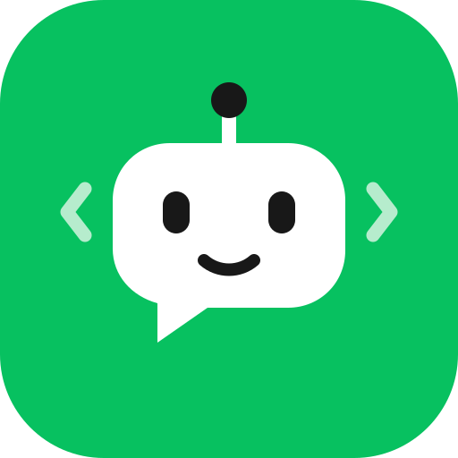
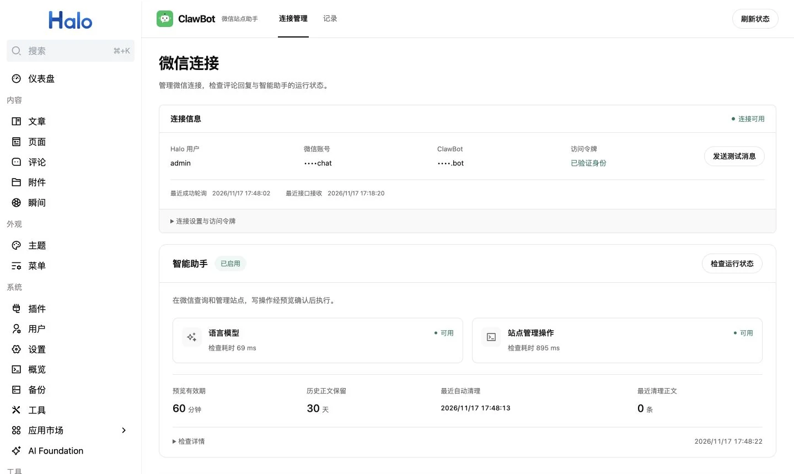
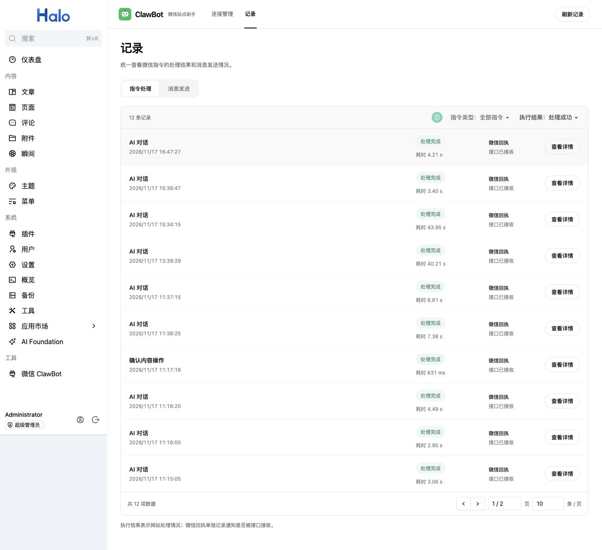
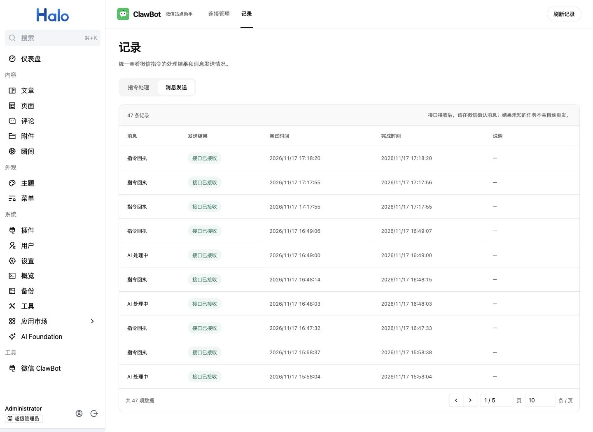

<p align="center">
  
</p>

<h1 align="center">微信 ClawBot</h1>

<p align="center">在微信里收评论、写内容、管理 Halo。</p>

<p align="center">
  <a href="https://www.halo.run/"></a>
  
  <a href="LICENSE"></a>
</p>

将微信 ClawBot 接入 Halo，把评论通知、引用回复、AI 内容创作和站点管理放进同一个聊天窗口。通过 AI Foundation 连接语言模型，由官方 Halo CLI 执行站点操作；AI 管理操作先展示预览，核对后再确认执行。

## 演示与交流

- **演示站**：[林间拾语 · xhhao.com](https://www.xhhao.com/)（Handsome）
- **使用文档**：[微信 ClawBot 完整指南](https://docs.xhhao.com/plugins/claw-bot-notify/)
- **下载**：[GitHub Releases](https://github.com/acanyo/plugin-claw-bot-notify/releases)
- **QQ 交流群**：[Halo 插件主题交流群 · 766203360](https://qm.qq.com/q/dSeDeVeotq)

<p align="center">
  <a href="https://www.xhhao.com/upload/iShot_2025-03-03_16.03.00.png">
    
  </a>
</p>

演示站展示公开内容，后台与微信私聊功能需在自己的 Halo 中安装并绑定。以下截图来自专用测试站的实际界面，微信身份已脱敏。

## 界面预览



<table>
  <tr>
    <td width="50%"></td>
    <td width="50%"></td>
  </tr>
  <tr>
    <td align="center">指令处理与结果核查</td>
    <td align="center">消息发送与微信回执</td>
  </tr>
</table>

## 功能

- **评论通知与引用回复**：接收文章、独立页面和瞬间的评论及访客楼中楼通知；在微信中引用通知直接回复，待审核内容再次确认后发布，也可让 AI 起草回复建议。
- **AI 对话与站点管理**：自然语言查询和管理文章、分类标签、评论、瞬间、附件、插件、主题和备份等，可用能力随 Halo CLI、站点插件与账号权限提供。
- **文章与长文创作**：生成、修改和发布文章草稿，正文最多 30,000 个 Unicode 字符；支持分段阅读、差异查看及版本号确认。
- **微信图片到 Halo**：上传附件、发布带图瞬间或设置文章封面；支持 PNG、JPEG、GIF，每条消息最多 9 张、每张最多 10 MiB，先预览再确认。
- **日报、周报与月报**：汇总真实站点统计、完成事项和 AI 原创寄语；支持手动发起，或按北京时间 21:00 定时生成预览，主人确认后才发布。
- **自选瞬间发布身份**：从已有 Halo 用户中选择 Bot 发布账号，文字、图片和报告瞬间统一使用所选身份，预览中显示作者。
- **执行记录与结果核查**：按类型和结果筛选，查看正文、模型与工具耗时；网站执行结果和微信回执分别记录，便于核查未知或部分完成的操作。

评论通知和手动引用回复可以独立使用，**新安装默认关闭 AI 助手**。

## 环境要求

| 项目          | 要求                                                            |
| ------------- | --------------------------------------------------------------- |
| Halo          | 2.27.0 或更高版本，Java 21                                      |
| AI Foundation | 1.0.0 或更高版本，安装插件前需先启用此依赖                      |
| AI 助手       | 支持工具调用的语言模型；环境引导页检测并安装 Halo CLI |
| 瞬间相关功能  | 安装并启用 Halo 瞬间插件。通过微信发布瞬间时需选择发布用户并授予对应权限 |

## 安装与绑定

**1.0.1** 新增密钥自动管理与环境安装引导。1.0.0 用户升级时请保留原主密钥。

1. 先安装并启用 AI Foundation，再上传微信 ClawBot JAR 并启用。安装包见 [1.0.3 Release](https://github.com/acanyo/plugin-claw-bot-notify/releases/tag/v1.0.3)。
2. 使用超级管理员打开「微信 ClawBot」，点击「绑定微信」并扫码，按提示核对微信身份。
3. 创建同一 Halo 用户的个人访问令牌，至少授予评论查看权限；需要引用回复时增加评论管理权限。粘贴令牌，验证后点击「确认并启用」。
4. 给 Bot 发送 `开始`，再用一条新评论验证通知。需要 AI 时，在插件设置中启用助手并选择模型，按实际操作授予令牌权限。

首次启用自动生成加密密钥，保存到 Halo 工作目录的 `clawbot/master.key`。打开「环境设置」引导页，插件会检测 **Halo 服务器**的系统、CPU 架构、已有 Node.js、CLI 和目录权限；点击「下载并安装」后才下载当前平台的 Node.js 运行版及固定版本 CLI，显示下载、校验和安装进度。已有兼容 Node.js 会复用，失败可重试。服务器需访问 `nodejs.org` 与 `registry.npmjs.org`；用户无需安装 npm、系统凭证库或执行 CLI 登录命令，授权与绑定 PAT 同步。可暂时跳过工具安装，先绑定微信。

**升级**：在插件管理中升级 JAR，已有微信绑定和设置会保留，无需重新扫码。

请单独备份 `clawbot/master.key`；恢复加密数据需要原密钥。旧部署的 `CLAWBOT_MASTER_KEY` 和 `CLAWBOT_HALO_CLI_EXECUTABLE` 配置继续优先使用，无需更换。若要从外部 CLI 切换到托管模式，仅移除 `CLAWBOT_HALO_CLI_EXECUTABLE` 后重启 Halo，再打开环境设置；保留原主密钥。令牌权限和连接管理见[安装与微信绑定](https://docs.xhhao.com/plugins/claw-bot-notify/installation)。

## 在微信里使用

| 场景           | 操作示例                                                 |
| -------------- | -------------------------------------------------------- |
| 查看待处理评论 | 发送 `待处理`，或用 `查看 C-编号` 获取详情               |
| 回复评论       | 引用单条通知或详情，直接输入回复正文                     |
| AI 回复建议    | 引用评论发送 `AI 帮我回复`，查看预览后按提示确认         |
| 查询站点内容   | 发送“查看最近发布的 5 篇文章”                            |
| 创作文章       | 发送“帮我写一篇关于周末徒步的文章，先给我看预览”         |
| 上传图片       | 发送图片，引用回执告诉 Bot“上传为附件”或“发布为带图瞬间” |
| 生成站点报告   | 发送“把本周博客总结成一条私密瞬间”                       |

需要 AI 的操作请先完成[AI 助手配置](https://docs.xhhao.com/plugins/claw-bot-notify/ai-assistant)。通用管理、评论、文章和图片操作使用不同的确认指令，请以预览提示为准；长文章和图片还需携带版本号。

定时报告在插件设置中开启，周期为按天、按周或按月，统一北京时间 21:00，周报为周日、月报为月末。生成后先通知主人，确认才发布。报告模板、称呼、默认可见性和发布用户均可设置，详见[日报、周报与月报](https://docs.xhhao.com/plugins/claw-bot-notify/reports)。

## 开发

构建环境：Java **21**、Node.js **22.12.0+**、pnpm **10.33.0**。项目使用 Gradle Wrapper **9.4.0** 和 Halo DevTools **0.9.0**。

在项目根目录执行：

```bash
./gradlew build
```

当前产物为 `build/libs/plugin-claw-bot-notify-1.0.3.jar`，构建包含 Java 测试、格式检查和 Vue 类型检查。

本地启动专用 Halo 开发实例：

```bash
./gradlew haloServer -Pport=18091
```

另开终端监听前端变更：

```bash
cd ui
pnpm install --frozen-lockfile
pnpm dev
```

修改 Java DTO 或接口定义后，运行 `./gradlew generateApiClient` 更新前端客户端。调试环境、会话配置和 API 约定见[构建与开发](https://docs.xhhao.com/plugins/claw-bot-notify/development)。

## 许可证

[GPL-3.0](LICENSE) © Handsome。微信协议所依据的官方实现许可与引用见[兼容性记录](docs/compatibility.md)。
